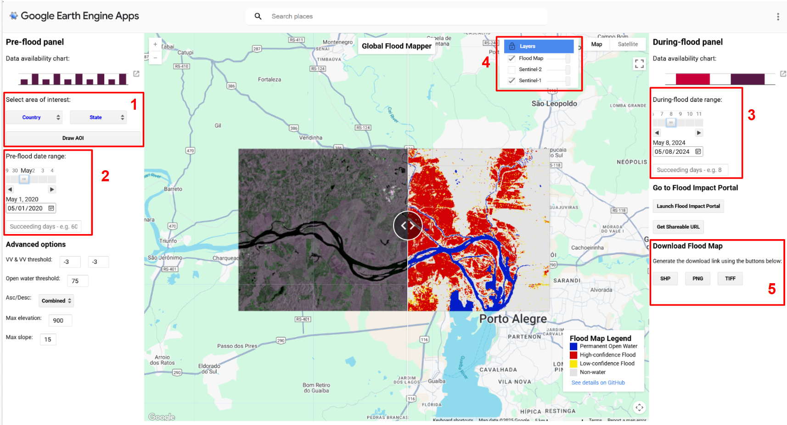
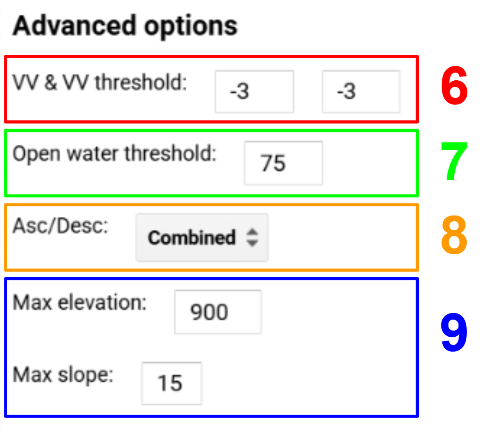
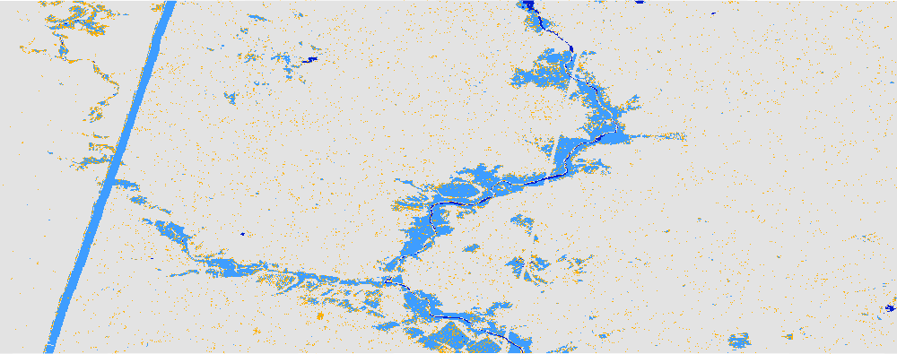
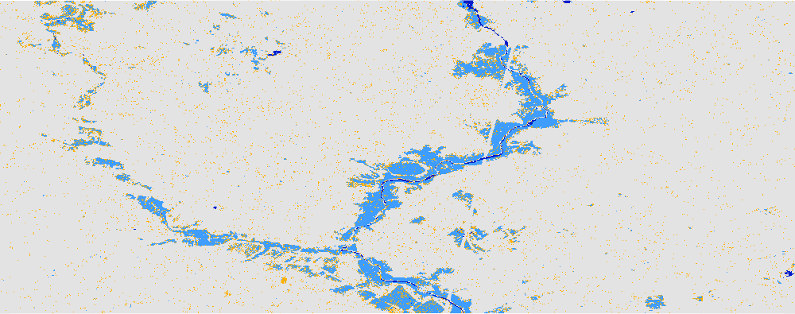
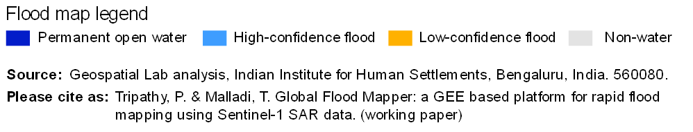
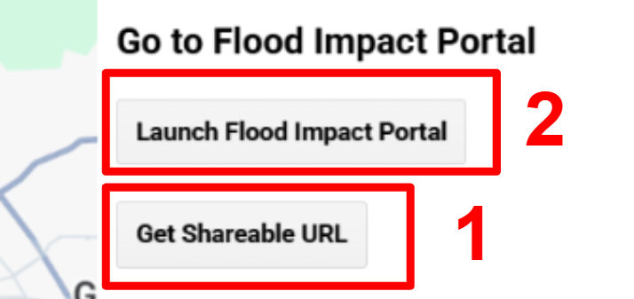
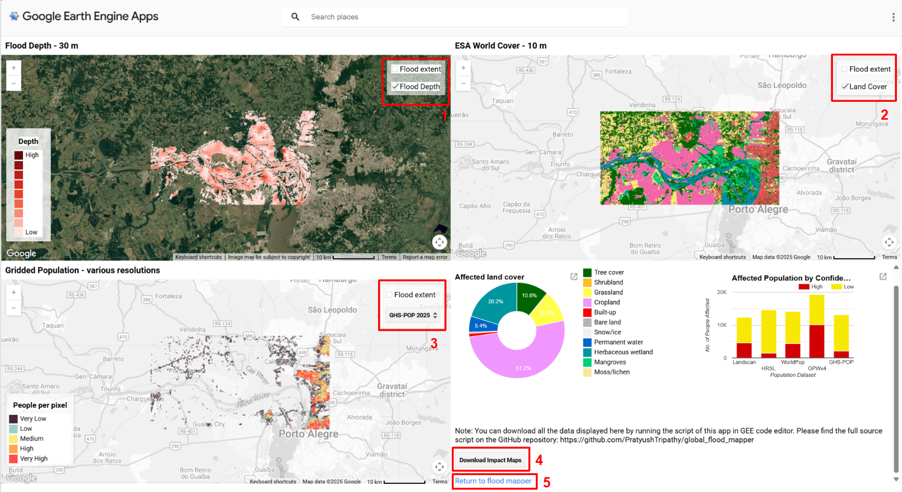

# Recommended steps to generate the flood map:  

1. Select the area of interest (AOI) for flood mapping. This can be done in two ways. 1) Select the country and state from the dropdown menu. 2) Draw a custom AOI by clicking the "Draw AOI" button.  
2. Select a date range of approximately one to two months before the floods. This is done with the pre-flood start date slider and the associated textbox for the number of succeeding days (defaults to 60).  
3. With some rough idea about the flood dates, select a date range. This should be the minimum number of days required to cover the area. The minimum number of scenes required to wholly cover an area should be determined by a test-and-trial approach, by trying out different values for the 'succeeding days' field.  
4. Switch off the flood map from the layers dropdown and toggle between the pre-flood image and the during-flood image using the slider in the center. Test a few values for the during-flood date range and finalize one that shows the most difference visually while toggling. Water/sand appears dark in color, but a change in black from the pre-flood image and during-flood image will only represent new water. Once finalized, turn on the flood map layer.  
5. Click on the download button to get the flood extent as a GeoTIFF, SHP, or PNG file. For quantitative analysis use the GeoTIFF or shapefiles; the PNG is for quick visualization only.  
    - **GeoTIFF** – the classified flood map itself: a single band (`flood_class`) of class values, not colours. `0` non-water, `1` low-confidence flood, `3` high-confidence flood, `4` permanent water, `255` no data (outside the AOI, or no Sentinel-1 coverage). With the smoothing radius set to 0, low confidence is split into `1` (VV-only) and `2` (VH-only), so count both.
    - **Set NoData to 255 when you open it.** The in-app download link marks `0` as NoData, which hides the non-water class in most GIS software. In QGIS: Layer Properties → Transparency → untick "No data value" and enter `255` under "Additional no data value". (The Google Drive export from the Code Editor is already marked correctly.)
    - **Styling.** Because the file holds numbers rather than colours, a GIS first shows it in grey or random colours. Style it by unique values (QGIS: Symbology → Paletted/Unique values) using the app's colours: `0` #E3E3E3, `1`/`2` #F8E806, `3` #D20103, `4` #031DC9.
    - **Detail.** The GeoTIFF defaults (400 m cells, smoothing radius 3) give a coarse, smoothed map. For a file that matches the map on screen, set the smoothing radius to 0 and a smaller cell size, and draw a smaller AOI: the download link is limited to roughly 22,500 km² at 100 m.
    - **SHP** – four shapefiles, one per class (non-water, low confidence, high confidence, permanent water), vectorized from the same smoothed classified raster.
    - **PNG** – a rendered image at a fixed width of 1000 px.
    - Small differences between the three outputs are expected: each is generated independently and on the fly at its own resolution (the PNG at 1000 px, the GeoTIFF and SHP at your chosen cell size, the SHP following pixel edges). We do not force them to align (e.g., with `reproject`), as this exceeds GEE's computation limits over large areas and would break the app's on-the-fly processing.

## Advanced options  

6. The VV and VH thresholds can be tweaked, both default to -3. Increasing it to -2 or -1, etc. will result in a lot more cells in the flood category.   
7. The valid range for the permanent open water (POW) threshold is 0 through 100, which defaults to 75. This can be tweaked to get desirable flood map.  
8. If the area of interest (AOI) is small enough and is covered by a single 'during-flood' scene, the orbit pass direction of that scene should be selected from the drop-down menu for best results. For large AOIs, if the flood inundation water stagnates for a small period, Ascending and Descending passes should be combined. In case inundated water stays for long enough duration and multiple images of different passes are available, the images of Ascending and Descending passes can be processed separately, which is the ideal way. All these four options are present in the drop down menu.  
9. On comparing the flood map with the Google Earth basemap and Sentinel-1 raw images, if flood class pixels are found on hills/valleys (most likely to result from combining the Ascending and Descending passes), the maximum elevation and slope allowed for the flood pixels can be reduced. The elevation and slope default to 900m and 15 degrees respectively.

## Common Mistakes  

1. If you see linear flood extent (like a proper line). It is most likely the edge of a SAR scene in the during-flood image. In such a case please try to select any other date near the first one. For e.g. the [Roscommon, Ireland 2016](../examples/2016) flood in the examples, a during-flood stretch of 09 to 11 Jan 2016 gave a linear feature, which I avoided by selecting 09 Jan 2016 as the during-flood date. 

	 
 

## Flood Impact Portal  

1. Click the "Get Shareable URL" button to save the existing parameters and/or share the flood extent map with other users.
2. Click the "Launch Flood Impact Portal" button and wait a few seconds for the portal to load. While processing, a loading symbol appears in the affected-population chart (bottom right) to show that a computation is running.

1. For the flood depth map, you can enable and disable both the flood depth map and the flood extent overlay.
2. For the land cover map, you can enable and disable both the land cover map and the flood extent overlay.
3. For the gridded population map, you can choose the dataset to use for the map calculations using the dropdown menu. You can also disable and enable the flood extent overlay.
4. To download the impact maps, you must run the script of the app in the Google Earth Engine Code Editor. Launching the portal creates Google Drive export tasks; start them from the Tasks tab. The GeoTIFFs hold data values, not colours, so style them in your GIS (a colour ramp for depth and population, unique values for land cover):
    - `Flood_Depth_Map` – flood depth in metres; `-9999` = not flooded or outside the AOI.
    - `Land_Cover_Map` – ESA WorldCover class codes (`10` tree cover, `20` shrubland, `30` grassland, `40` cropland, `50` built-up, `60` bare/sparse vegetation, `70` snow and ice, `80` permanent water, `90` herbaceous wetland, `95` mangroves, `100` moss and lichen); `0` = no data.
    - `Gridded_Population_Map_<dataset>` – people per cell on the dataset's own grid (so cell values are not comparable across datasets with different cell sizes); `-9999` = no data. A task is created for the dataset selected in the population dropdown; select another dataset to create a task for it.
5. Click the "Return to flood mapper" text to return to the Global Flood Mapper. 

Depending on the size of the area of interest, GFM v2 may take some time to display the data, so allow it to run for a few minutes, if needed.
